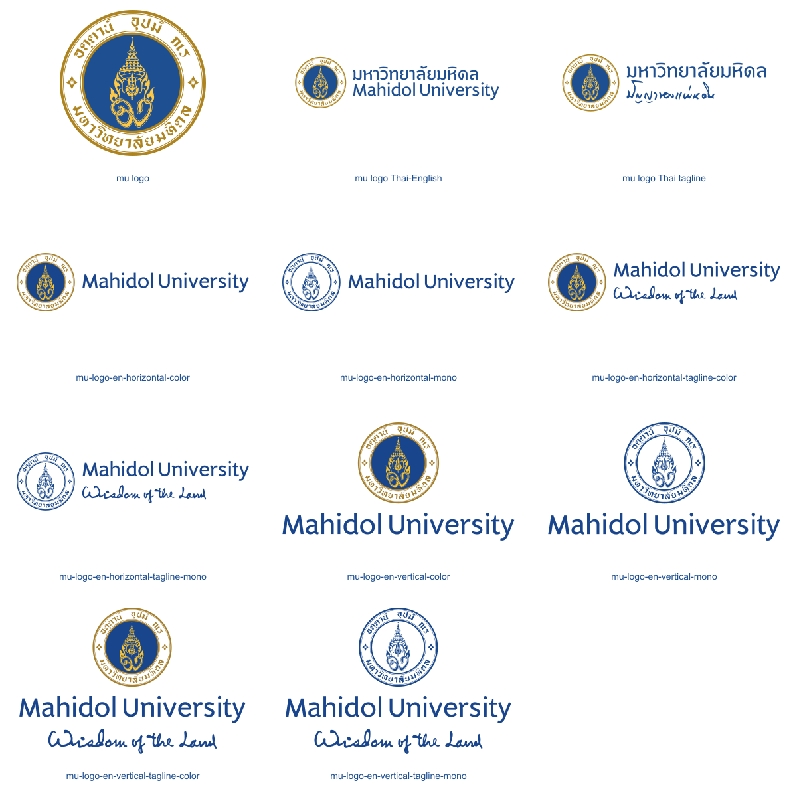
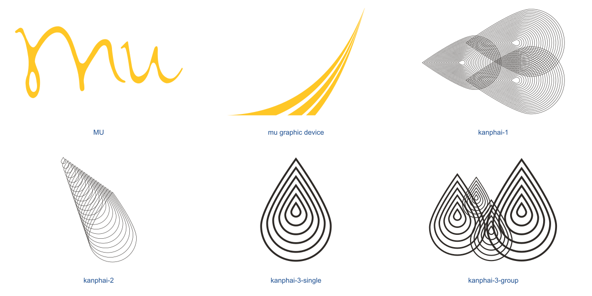
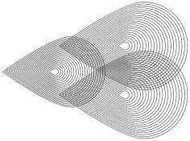

# Mahidol CI

ปลั๊กอินแบบ skills-only สำหรับสร้างและตรวจสื่อประชาสัมพันธ์ตาม Mahidol CI พร้อมข้อกำหนดสีและตัวอย่าง SVG **17 แบบ** ใช้งานได้โดยไม่ต้องตั้งค่า MCP server หรือ API key

## สิ่งที่มีในชุดนี้

| หมวด | องค์ประกอบ | จำนวน |
| --- | --- | --- |
| โลโก้มหาวิทยาลัย | ตราและชุดชื่อมหาวิทยาลัย ทั้งภาษาไทยและอังกฤษ | 11 แบบ |
| กราฟิกเสริม | ตัว MU | 1 แบบ |
| กราฟิกเสริม | เส้นโค้งสามเส้นสีเหลือง | 1 แบบ |
| กราฟิกเสริม | ดอกกันภัย | 4 แบบ |

รวม SVG 17 ไฟล์ แยกตัวอย่างโลโก้และกราฟิกเสริมไว้ด้านล่าง

## การติดตั้งแบบ Local (Codex)

1. ดาวน์โหลด repository ด้วย **Code → Download ZIP** แล้วแตกไฟล์
2. คัดลอกโฟลเดอร์ **mahidol-ci** จาก **plugins/mahidol-ci/skills/mahidol-ci/** ทั้งโฟลเดอร์
3. วางไว้ใน **.agents/skills/** ภายในโปรเจกต์ที่ต้องการใช้งาน ให้ได้โครงสร้างดังนี้:

       your-project/
       └── .agents/
           └── skills/
               └── mahidol-ci/
                   ├── SKILL.md
                   └── assets/
                       └── ... SVG 17 ไฟล์

4. เปิดโปรเจกต์นั้นใน Codex แล้วเริ่มแชตใหม่ หากยังไม่พบ skill ให้ปิดและเปิดโปรเจกต์อีกครั้ง
5. เรียกใช้ด้วยคำขอ เช่น **“ใช้ $mahidol-ci สร้างแบนเนอร์ตาม Mahidol CI”**

วิธีนี้ติดตั้ง skill ในโปรเจกต์โดยตรง ไม่ต้องเพิ่ม marketplace ไม่ต้องตั้งค่า MCP server และไม่ต้องคัดลอก plugin.json หรือ marketplace.json ไปด้วย เก็บ SKILL.md และ assets/ ไว้คู่กันเสมอ

## ใช้เป็นไฟล์ skill

ใช้ [SKILL.md](plugins/mahidol-ci/skills/mahidol-ci/SKILL.md) พร้อมโฟลเดอร์ [assets/](plugins/mahidol-ci/skills/mahidol-ci/assets/) โดยเก็บไว้ในโฟลเดอร์เดียวกัน หากแนบในแชต ให้แนบ SKILL.md และ SVG ที่ต้องใช้ด้วย ไฟล์ SKILL.md เป็นคำแนะนำและไม่ได้ฝังโค้ด SVG การแนบไฟล์ไม่ได้ทำให้ทุกระบบติดตั้ง skill โดยอัตโนมัติ

ตัวอย่างคำขอ:

> ใช้ Mahidol CI จากไฟล์แนบ สร้างแบนเนอร์ Facebook ขนาด 1200 × 630 px สำหรับประกาศรับสมัครนักศึกษา ใช้ตราพร้อมชื่อไทย–อังกฤษและเส้นโค้งสีเหลือง ดึง SVG จากต้นฉบับโดยตรง

## รหัสสี

**แหล่งหลัก:** ยึด `CI-system2567.pdf` ซึ่งเป็นฉบับล่าสุดในชุดที่ผู้ใช้ให้ เมื่อข้อมูลขัดกันกับ `CI-Manual.pdf` หรือ `Graphic2021.pdf` ให้ใช้ฉบับนี้ก่อน หน้า PDF 8 (หน้าในเล่ม 4) ระบุปรับปรุงวันที่ 7 ธันวาคม 2566; อย่าอนุมานวันที่ปรับปรุงจากชื่อไฟล์เพียงอย่างเดียว ใช้ Graphic2021 เสริมเฉพาะรายละเอียดระบบ MU ที่ฉบับหลักไม่ได้ระบุ

**สีตราสัญลักษณ์มาตรฐานและสีหลัก–รอง:** ตาม CI-system2567 หน้า PDF 8 และ 52 (หน้าในเล่ม 4 และ 48)

| สี | CMYK | Pantone |
| --- | --- | --- |
| Mahidol Blue | 100/84/12/4 | 286 C |
| Mahidol Yellow | 2/24/90/0 | 123 C |
| Mahidol Gold | 33/46/100/10 | 1255 C |

ตารางฉบับหลักไม่ระบุ RGB/HEX จึงไม่ใช้ค่า `#1D4F91`, `#FFC845`, `#AD841F` จาก CI-Manual เป็นมาตรฐานล่าสุด และไม่แปลง Pantone/CMYK เป็น HEX โดยประมาณ คงสีใน SVG master ที่ได้รับ; หากต้องรับรองว่า master ตรงฉบับล่าสุด ให้ตรวจแหล่งที่มาหรือขอ master ที่ยืนยันแล้ว ไม่อ้างว่าได้ปรับสีไฟล์ให้เป็นฉบับล่าสุด

**สีสนับสนุน:** ตาม CI-system2567 หน้า PDF 52

| สี | CMYK | Pantone ที่ระบุในคู่มือ |
| --- | --- | --- |
| เหลืองอ่อน | 0/5/35/0 | 7401 C |
| น้ำตาลอ่อน | 40/45/50/5 | 4725 C |
| น้ำตาลเข้ม | 18/56/100/70 | 732 C |
| เทาอ่อน | 28/21/18/1 | 5 C |
| เทา | 0/8/0/75 | 411 C |
| เทาเข้ม | 10/0/0/85 | 446 C |
| ฟ้า | 47/0/7/0 | 7401 C — ต้องยืนยันก่อนใช้สีพิเศษ |

ค่า Pantone ของสีฟ้าซ้ำกับเหลืองอ่อนในต้นฉบับ ให้แจ้งความคลุมเครือและขอคำยืนยันก่อนผลิตด้วย Pantone ไม่แก้เลขเองหรือย้อนใช้ค่าเก่าโดยไม่แจ้ง; ไม่มีค่า RGB/HEX ของสีสนับสนุนในตารางนี้

**โลโก้ชื่ออังกฤษชุดเพิ่มเติม 8 แบบ:** เลือกไฟล์สีเต็มหรือสีน้ำเงินสีเดียวตามงาน และคงค่าสีที่ฝังใน SVG ที่ผู้ใช้จัดเตรียมไว้ ห้ามแปลงเวอร์ชันสีเอง ไฟล์ชื่อที่มี tagline ต้องคงข้อความ “Wisdom of the Land” ตาม artwork

**Graphic Device:** ใช้กฎสีแยกตามองค์ประกอบดังนี้:

| องค์ประกอบ | สีใน SVG |
| --- | --- |
| `MU` | ตัว MU เหลือง `#FFC726` (RGB 255/199/38) เท่านั้น |
| `kanphai-1`, `kanphai-2`, `kanphai-3-single`, `kanphai-3-group` | ดำ `#2D2926` (RGB 45/41/38) |
| `mu graphic device` | ตัวอย่างเหลือง `#FFC726`; เลือกสี CI ที่ยืนยันแล้ว รวมถึงขาวและดำได้ |

ค่า CMYK และ Pantone ในตารางใช้ระบุสีของตรามาตรฐาน ส่วน SVG เป็นไฟล์สี RGB สำหรับงานดิจิทัล การผลิตงานพิมพ์ต้องตรวจ master และข้อกำหนดขององค์ประกอบนั้นอีกครั้ง

**ชุดสีระบบ MU ตาม Graphic2021 หน้า 3:** ใช้ RGB/HEX สำหรับดิจิทัล และ CMYK/Pantone สำหรับงานพิมพ์ ไม่แปลงค่าสีประมาณเอง ตารางนี้เป็น palette ไม่ใช่สิทธิ์เปลี่ยนสีทุกองค์ประกอบ; ใช้ร่วมกับกฎของแต่ละ artwork ข้างต้น

| สี | HEX | RGB | CMYK | Pantone |
| --- | --- | --- | --- | --- |
| น้ำเงิน | `#0035AD` | 0/53/173 | 100/84/12/4 | 286 C |
| เหลือง | `#FFC726` | 255/199/38 | 2/24/90/0 | 123 C |
| ดำ | `#2D2926` | 45/41/38 | 65/66/68/82 | Black |
| เทา | `#B1B3B3` | 177/179/179 | 28/21/18/1 | Cool Gray 5 C |
| ขาว | `#FFFFFF` | 255/255/255 | 0/0/0/0 | White |

อ้างอิง: [Graphic2021 — หน้า 3](https://mahidol.ac.th/documents/Graphic/Graphic2021.pdf#page=3) ตารางหน้า 3 กล่าวถึงระบบตัวอักษร MU; การอนุญาตเปลี่ยนสีเส้นโค้งในชุดนี้มาจากคำยืนยันของผู้ใช้ ไม่อนุมานว่าคู่มือหน้านี้ครอบคลุมทุก artwork

เส้นโค้งสามเส้นเปลี่ยนเป็นสีตาม CI ที่ยืนยันแล้ว รวมถึงขาวและดำได้ ไม่ล็อกเฉพาะสีเหลือง ห้ามใช้สีนอก CI เช่น แดง ชมพู เขียว คง path และสัดส่วนเดิม ไม่วาดใหม่ ไม่ flip/rotate; gradient ที่มีใน master คงไว้ได้ แต่ไม่สร้าง gradient หรือปรับ opacity ขึ้นเอง

โลโก้ ตัว MU และดอกกันภัยยังคงสีของ master เดิม ตัว MU ในชุดปัจจุบันใช้เฉพาะสีเหลือง ไม่มีชื่อมหาวิทยาลัยสีน้ำเงิน

## ตัวอย่าง SVG ทั้ง 17 แบบ

คลิกชื่อเพื่อเปิดไฟล์ SVG ขนาด preview ไม่ใช่ข้อกำหนดขนาดใช้งานหรือระยะเว้นรอบ

### โลโก้มหาวิทยาลัย — 11 แบบ

| ชื่อเรียก | ตัวอย่าง SVG | ลักษณะ |
| --- | --- | --- |
| [mu logo](plugins/mahidol-ci/skills/mahidol-ci/assets/mu-logo.svg) |  | ตราวงกลมอย่างเดียว เมื่อรูปแบบงานกำหนด |
| [mu logo Thai-English](plugins/mahidol-ci/skills/mahidol-ci/assets/mu-logo-thai-english.svg) |  | ตราพร้อมชื่อไทย–อังกฤษ |
| [mu logo Thai tagline](plugins/mahidol-ci/skills/mahidol-ci/assets/mu-logo-thai-tagline.svg) |  | ตราพร้อมชื่อไทยและ “ปัญญาของแผ่นดิน” |
| [mu-logo-en-horizontal-color](plugins/mahidol-ci/skills/mahidol-ci/assets/mu-logo-en-horizontal-color.svg) |  | ตราพร้อมชื่ออังกฤษ แนวนอน สีเต็ม |
| [mu-logo-en-horizontal-mono](plugins/mahidol-ci/skills/mahidol-ci/assets/mu-logo-en-horizontal-mono.svg) |  | ตราพร้อมชื่ออังกฤษ แนวนอน สีน้ำเงินสีเดียว |
| [mu-logo-en-horizontal-tagline-color](plugins/mahidol-ci/skills/mahidol-ci/assets/mu-logo-en-horizontal-tagline-color.svg) |  | ตราพร้อมชื่ออังกฤษและ tagline แนวนอน สีเต็ม |
| [mu-logo-en-horizontal-tagline-mono](plugins/mahidol-ci/skills/mahidol-ci/assets/mu-logo-en-horizontal-tagline-mono.svg) |  | ตราพร้อมชื่ออังกฤษและ tagline แนวนอน สีน้ำเงินสีเดียว |
| [mu-logo-en-vertical-color](plugins/mahidol-ci/skills/mahidol-ci/assets/mu-logo-en-vertical-color.svg) |  | ตราพร้อมชื่ออังกฤษ แนวตั้ง สีเต็ม |
| [mu-logo-en-vertical-mono](plugins/mahidol-ci/skills/mahidol-ci/assets/mu-logo-en-vertical-mono.svg) |  | ตราพร้อมชื่ออังกฤษ แนวตั้ง สีน้ำเงินสีเดียว |
| [mu-logo-en-vertical-tagline-color](plugins/mahidol-ci/skills/mahidol-ci/assets/mu-logo-en-vertical-tagline-color.svg) |  | ตราพร้อมชื่ออังกฤษและ tagline แนวตั้ง สีเต็ม |
| [mu-logo-en-vertical-tagline-mono](plugins/mahidol-ci/skills/mahidol-ci/assets/mu-logo-en-vertical-tagline-mono.svg) |  | ตราพร้อมชื่ออังกฤษและ tagline แนวตั้ง สีน้ำเงินสีเดียว |

### กราฟิกเสริม — 6 แบบ

ใช้ประกอบการจัดวางสื่อ โดยเลือกแยกจากโลโก้มหาวิทยาลัย

#### ตัว MU

| ชื่อเรียก | ตัวอย่าง SVG | ลักษณะ |
| --- | --- | --- |
| [MU](plugins/mahidol-ci/skills/mahidol-ci/assets/mu.svg) |  | ตัว MU เท่านั้น |

#### เส้นโค้งสามเส้นสีเหลือง

| ชื่อเรียก | ตัวอย่าง SVG | ลักษณะ |
| --- | --- | --- |
| [mu graphic device](plugins/mahidol-ci/skills/mahidol-ci/assets/mu-graphic-device.svg) |  | เส้นโค้งสามเส้นสีเหลือง |

#### ดอกกันภัย — 4 แบบ

| ชื่อเรียก | ตัวอย่าง SVG | ลักษณะ |
| --- | --- | --- |
| [kanphai-1](plugins/mahidol-ci/skills/mahidol-ci/assets/kanphai-1.svg) |  | ดอกกันภัยแนวทาง 1 |
| [kanphai-2](plugins/mahidol-ci/skills/mahidol-ci/assets/kanphai-2.svg) |  | ดอกกันภัยแนวทาง 2 |
| [kanphai-3-single](plugins/mahidol-ci/skills/mahidol-ci/assets/kanphai-3-single.svg) |  | ดอกกันภัยแนวทาง 3 แบบเดี่ยว |
| [kanphai-3-group](plugins/mahidol-ci/skills/mahidol-ci/assets/kanphai-3-group.svg) |  | ดอกกันภัยแนวทาง 3 แบบกลุ่ม |

## ข้อกำหนดการใช้ artwork

- ใช้ไฟล์ SVG ต้นฉบับจาก assets/ ตามที่ SKILL.md ระบุ ห้ามเขียน path ใหม่ ประมาณรูปทรง trace หรือใช้ AI วาดทดแทน
- ห้าม flip, mirror, rotate หรือยืดบิดสัดส่วน
- ใช้กฎสีของแต่ละองค์ประกอบข้างต้น ห้ามเติมเงา เส้นขอบ gradient หรือเอฟเฟกต์ใหม่; คง gradient ที่มีอยู่ใน master ได้
- ห้ามเปลี่ยนตัวอักษรที่เป็น artwork ในโลโก้ด้วยฟอนต์
- รักษาระยะเว้นรอบและขนาดขั้นต่ำตามคำแนะนำใน skill ตรวจความชัดเจนและการตัดขอบในไฟล์ส่งออกจริง
- MU ในแพ็กเกจนี้เป็นเวอร์ชันที่ตัดชื่อมหาวิทยาลัยและ tagline ออกตามคำขอ ไม่ควรใช้ไฟล์นี้เป็นหลักฐานว่าเป็น master ทางการสำหรับทุกกรณี

## โครงสร้างไฟล์

| ไฟล์หรือโฟลเดอร์ | หน้าที่ |
| --- | --- |
| [.agents/plugins/marketplace.json](.agents/plugins/marketplace.json) | รายการปลั๊กอินของ marketplace |
| [plugins/mahidol-ci/plugin.json](plugins/mahidol-ci/plugin.json) | ข้อมูลปลั๊กอินและเวอร์ชัน |
| [SKILL.md](plugins/mahidol-ci/skills/mahidol-ci/SKILL.md) | จุดเข้าใช้งาน skill สำหรับระบบที่รองรับ |
| [assets/](plugins/mahidol-ci/skills/mahidol-ci/assets/) | ไฟล์เวกเตอร์ 17 ไฟล์ ตรงกับตัวอย่างทั้ง 17 แบบ |

## อ้างอิง

[Mahidol University — Corporate Identity & Logo](https://mahidol.ac.th/corporate-identity-logo/)
